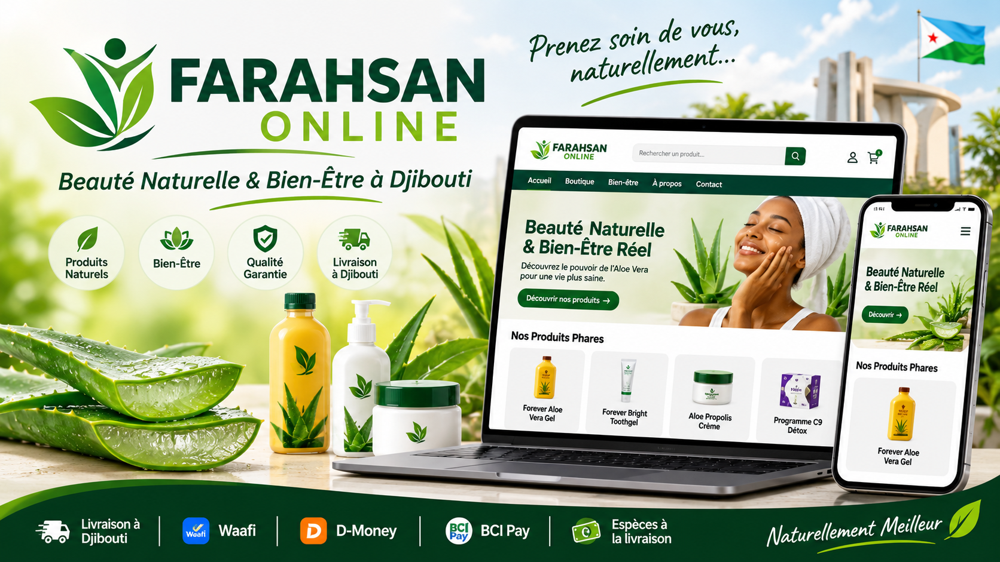

# 🌿 FARAHSAN ONLINE — Official Djibouti Store

  

  
  
  
  
  
  

  <strong>Natural Beauty · Wellness · Aloe Vera</strong>

  A multilingual e-commerce platform dedicated to Forever Living Products and natural wellness in Djibouti.

  <a href="https://edenunix.github.io/Farhasan-Online/">
    <strong>🌐 VISIT THE OFFICIAL STORE</strong>
  </a>
  &nbsp;·&nbsp;
  <a href="https://github.com/edenunix/Farhasan-Online">
    <strong>💻 SOURCE CODE</strong>
  </a>

---
